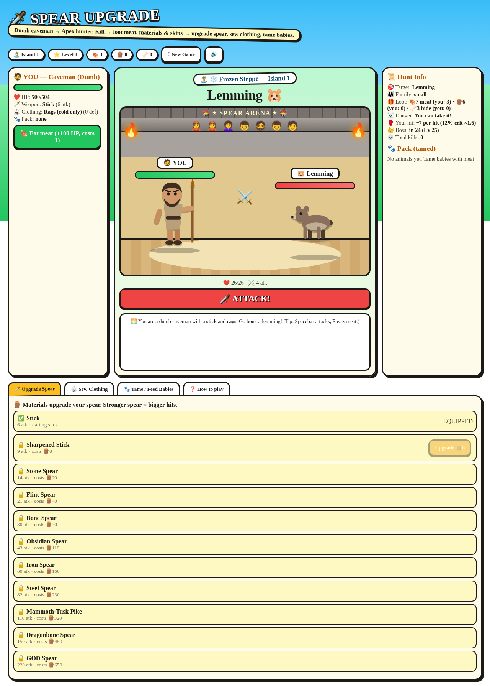

# 🗡️ Spear Upgrade



A cartoon Ice Age caveman hunting game. Kill beasts, loot meat/materials/hides,
upgrade your spear, sew disguises, tame baby animals that fight beside you.
Boss every 25 levels, new island after each boss, permadeath throughout.

## Play locally

Open `index.html` in any browser (no build, no server needed).
A synced copy also lives at `~/spear-upgrade.html` for double-click play.

## Deploy

Live site: https://spear-upgrade.vercel.app (auto-deploys on push to `main`).

Manual deploy if needed:

```sh
./deploy.sh
```

## Online accounts + world leaderboard

Same pattern as `neon-survivor` / `underrealm`: Python serverless functions in
`api/` (`register`, `login`, `me`, `scores`, `hunt_end`) backed by the shared
`underrealm-redis` Upstash store (keys under `spearupgrade/`), with a local
`./data/*.json` fallback for offline dev and tests.

- Needs the store connected (`vercel storage connect underrealm-redis`)
  plus a `SESSION_SECRET` env var (production + preview).
- Run `./tests/run.sh` before pushing: API compile, store units, Upstash
  protocol mapping tests, full HTTP roundtrip on a temp local store, and a
  game JS syntax check.

## Controls

- **Spacebar** or ATTACK button — attack
- **E** — eat meat (+100 HP)
- Tabs — upgrade spear 🗡️, sew clothing 🥋, tame/feed babies 🐾
